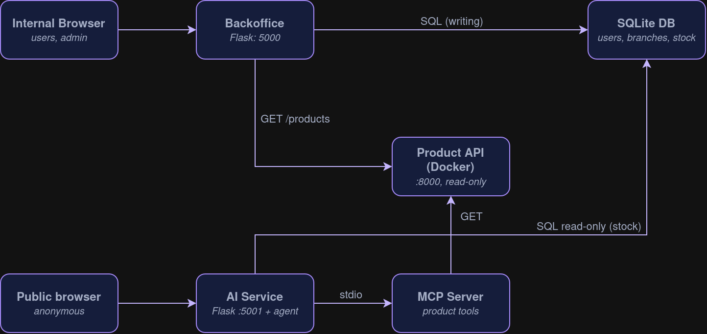

# System Architecture
## Services
- **Backoffice** `(Flask, port 5000)`: internal users, stocks and accounts management.
- **Relational Data Base** `(SQLite and SQLAlchemy)`: users, branches and stocks.
- **Product API** `(Docker, port 5001, read only)`: products source.
- **Product MCP Server**: bridge between AI agent and Product API.
- **AI Query Service** `(Flask, port 5001)`: AI agent which respond to queries.
- **Web client**: public page (queries + answers).

## Responsibilities
- **Backoffice**: authentication, authorisation (admin / common), update the stocks and accounts.
- **AI Agent Query Service**: understand the query, call the right tools and answer correctly.
- **Prodcut MCP Server**: expose 2 tools (list and details) and translate errors.

## Communication
- **Browser -> Backoffice**: HTTP + JSON (REST), session token.
- **Browser -> AI Query Service**: HTTP POST /ask (REST).
- **AI Query Service -> Product MCP Server**: MCP by stdio.
- **Backoffice and MCP Server -> Product API**: HTTP GET.

## Data
- **Local data**: users, branches, stocks by branche, id and product.
- **External data**: names, descriptions, prices, details.

## AI
- **Products**: MCP tools list_products and get_product.
- **Stock**: database read-only requests function.

## Diagram

